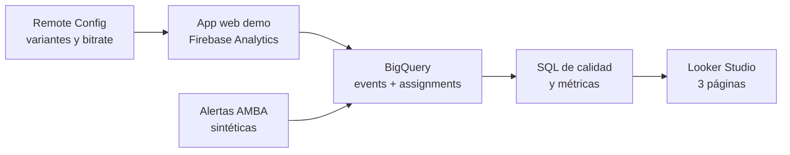

# Streaming QoE Analytics

Caso de estudio end-to-end para monitorear la calidad de experiencia (QoE) de una plataforma de streaming, diagnosticar microcortes y evaluar mediante un experimento A/B un flujo de autogestión.

> **Aviso:** proyecto independiente de portfolio, construido con datos 100% sintéticos. No representa información, resultados ni una implementación oficial de Personal Flow.

## Qué demuestra

- Diseño de tracking con eventos compatibles con un modelo GA4/Firebase.
- Generación reproducible de 4.000 usuarios y 39.265 eventos.
- Asignación A/B estable por usuario, sin contaminación entre variantes.
- Modelado y análisis en BigQuery con controles de calidad.
- Diseño de un dashboard ejecutivo en Looker Studio.
- Prototipo web instrumentado con Firebase Analytics y Remote Config.
- Traducción de señales técnicas en KPIs de experiencia y costos operativos.

## Preguntas de negocio

1. ¿Dónde y por qué ocurren los microcortes?
2. ¿Qué porcentaje de incidentes puede resolverse sin visita técnica?
3. ¿El diagnóstico inteligente mejora la contención frente al reinicio genérico?
4. ¿Qué impacto potencial tienen las visitas evitadas y el streaming en roaming?

## Arquitectura



Para publicar el proyecto hoy, los CSV se cargan manualmente en BigQuery. La exportación nativa de Firebase puede tardar hasta 48 horas, por lo que queda documentada como evolución de la arquitectura.

## Resultados de validación del experimento sintético

| Variante | Usuarios | Activados | Contención 7 días | Visita técnica |
|---|---:|---:|---:|---:|
| Control: reinicio genérico | 2.020 | 1.646 | 63,12% | 36,88% |
| Tratamiento: diagnóstico inteligente | 1.980 | 1.634 | 67,07% | 32,93% |

- Diferencia de contención: **+3,95 puntos porcentuales**.
- IC 95% de la diferencia: **+0,69 a +7,21 pp**.
- El resultado es una simulación diseñada para practicar análisis experimental; no es evidencia de impacto real.

## Estructura

```text
data/             CSV listos para BigQuery + generador reproducible
sql/              creación de tablas, vistas, análisis y pruebas de calidad
docs/             arquitectura, diccionario, QA y checklist de publicación
firebase-demo/    prototipo instrumentado para Analytics y Remote Config
looker/           guía exacta para construir el dashboard
LINKEDIN_POST.md  texto breve y honesto para publicar
```

## Inicio rápido

1. Crear en BigQuery el dataset `streaming_qoe_analytics` en ubicación `southamerica-east1`.
2. Cargar los cuatro CSV de `data/` usando autodetección y los nombres indicados en `docs/publish_today.md`.
3. Ejecutar los archivos de `sql/` en orden y reemplazar `YOUR_PROJECT_ID` por el ID real del proyecto.
4. Conectar Looker Studio a las vistas siguiendo `looker/dashboard_build_guide.md`.
5. Copiar `firebase-demo/firebase-config.example.js` como `firebase-config.js`, completar la configuración y servir la carpeta localmente.

## Stack

BigQuery · SQL · Looker Studio · Firebase Analytics · Remote Config · JavaScript · Python · experimentación A/B

## Reproducibilidad

```powershell
python data/generate_data.py
```

El generador usa una semilla fija (`20261015`) y conserva una sola variante por usuario mediante hashing estable.

