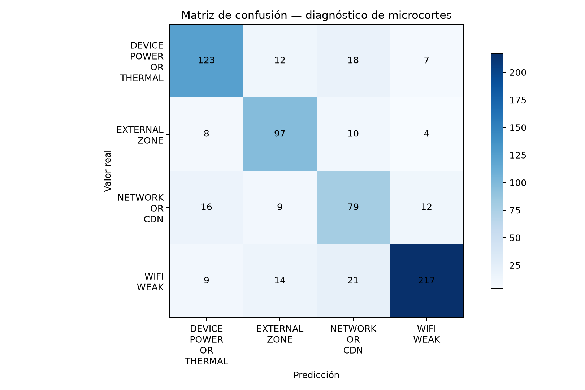
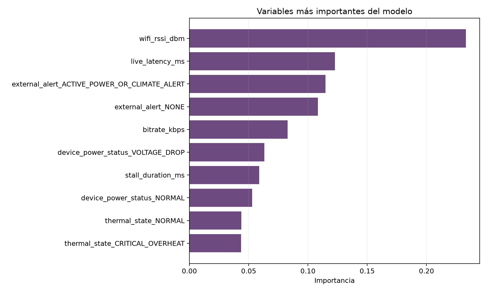

# Model card — diagnóstico de causa raíz

## Resumen

Random Forest multiclase que clasifica la causa probable de un microcorte de
streaming utilizando señales disponibles al momento de detección. El modelo es
un componente demostrativo del flujo de autodiagnóstico; no toma decisiones
reales ni fue validado con datos productivos.

## Datos

- Fuente: simulación reproducible incluida en el repositorio.
- Incidentes: 3.280.
- División: 80% entrenamiento y 20% prueba, estratificada.
- Clases: Wi-Fi débil, energía/temperatura del dispositivo, incidente externo de
  zona y red/CDN.
- Semilla de entrenamiento: `20261019`.

La simulación incorpora solapamiento entre clases, lecturas incompletas y falsos
positivos. Así se evita obtener métricas artificialmente perfectas.

## Evaluación

| Métrica | Resultado |
|---|---:|
| Accuracy en prueba | 78,66% |
| Balanced accuracy en prueba | 77,41% |
| Macro F1 en prueba | 76,63% |
| Balanced accuracy de línea base | 25,00% |
| Balanced accuracy CV (5 folds) | 78,60% ± 2,49 pp |

## Controles contra fuga de información

El entrenamiento excluye explícitamente:

- la causa diagnosticada, salvo como variable objetivo;
- el resultado de resolución;
- la solicitud posterior de visita técnica;
- cualquier evento ocurrido después del diagnóstico.

## Uso previsto

Priorizar la acción de autogestión que se mostraría al usuario después de
detectar un microcorte. La predicción puede alimentar una experiencia guiada y
ser evaluada mediante el experimento A/B ya incluido en el proyecto.

## Limitaciones

- Todos los datos son sintéticos.
- La importancia de variables no implica causalidad.
- Antes de usar el modelo en producción habría que validar calidad, sesgos,
  calibración, deriva y rendimiento con telemetría real.
- Este modelo diagnostica una causa probable luego de detectar el incidente; no
  afirma prevenir todos los microcortes antes de que ocurran.
