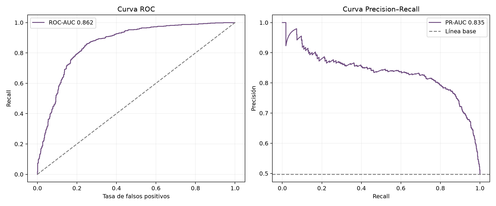
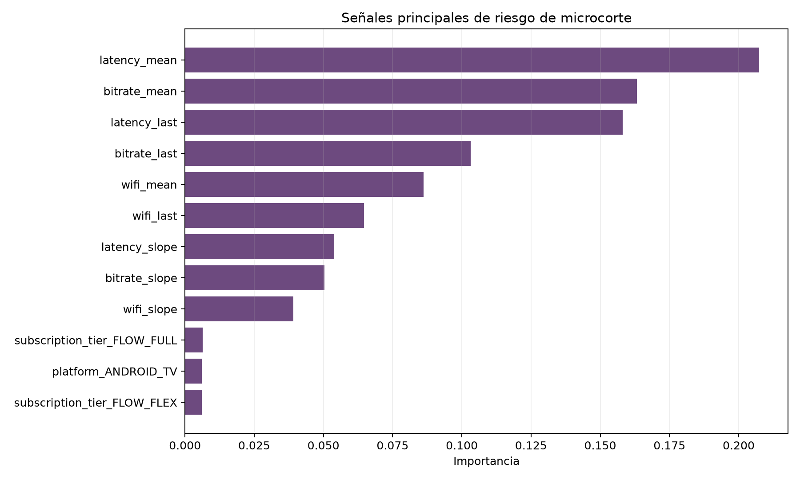

# Model card — alerta temprana de microcortes

## Resumen

Clasificador binario que estima el riesgo de que una sesión de streaming tenga
un microcorte en los próximos cinco minutos. Resume las últimas tres señales de
telemetría disponibles y produce una probabilidad de riesgo entre 0 y 1.

## Datos y ventana temporal

- Fuente: simulación reproducible incluida en el repositorio.
- Ventanas de sesión: 6.775.
- Tasa de positivos: 48,41%.
- Horizonte: próximos cinco minutos.
- División por usuario: 3.200 usuarios en entrenamiento y 800 en prueba.
- Usuarios compartidos entre entrenamiento y prueba: **0**.

La simulación incluye incidentes con señales previas débiles y sesiones sanas
con degradaciones transitorias. Esto evita que el objetivo sea perfectamente
separable.

## Evaluación

| Métrica | Resultado |
|---|---:|
| Accuracy | 79,95% |
| Balanced accuracy | 79,97% |
| Precision | 78,25% |
| Recall | 82,63% |
| F1 | 80,38% |
| ROC-AUC | 86,22% |
| PR-AUC | 83,45% |
| ROC-AUC línea base | 50,00% |
| ROC-AUC CV (5 folds) | 85,01% |

## Controles contra fuga de información

- Las variables finalizan antes del horizonte de predicción.
- La etiqueta solo observa microcortes posteriores dentro de cinco minutos.
- Los usuarios de entrenamiento y prueba son disjuntos.
- Se excluyen causa diagnosticada, resolución y solicitud de visita.

## Uso previsto

Activar una alerta o una intervención preventiva —por ejemplo, reducción
temporal de bitrate o recomendación de conectividad— cuando la probabilidad
supere un umbral operativo. El umbral final debería definirse según el costo de
una falsa alarma frente al costo de no anticipar un microcorte.

## Limitaciones

- Datos completamente sintéticos.
- No demuestra desempeño en clientes ni infraestructura reales.
- Requiere validación temporal, calibración, monitoreo de deriva y análisis de
  impacto antes de cualquier aplicación productiva.
